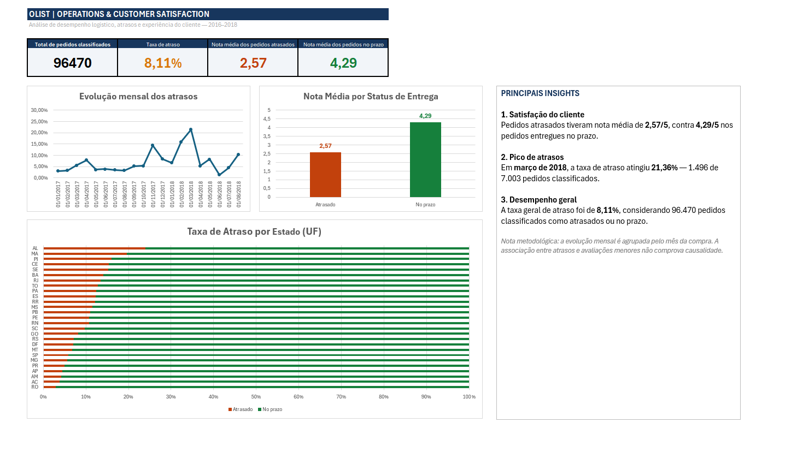

# Olist Operations & Customer Satisfaction Analysis — Excel

## Overview
Este projeto analisa o desempenho logístico e a satisfação dos clientes de um e-commerce brasileiro utilizando Microsoft Excel e Power Query.

O objetivo é transformar dados operacionais brutos em indicadores e visualizações que ajudem a investigar atrasos nas entregas, diferenças regionais e a relação entre prazo de entrega e avaliação dos clientes.

## Business Questions
- Qual é a taxa de atraso entre os pedidos classificados como entregues dentro ou fora do prazo?
- Como a taxa de atraso varia ao longo dos meses?
- Existem diferenças de desempenho logístico entre os estados brasileiros?
- Como as avaliações médias variam entre pedidos atrasados e pedidos entregues no prazo?

## Tools & Techniques
- **Microsoft Excel:** Tabelas Dinâmicas, gráficos dinâmicos, fórmulas e dashboard executivo.
- **Power Query (Linguagem M):** Importação, transformação, agrupamento e mesclagem das tabelas.
- **Data Preparation:** Agregação de itens e avaliações por identificador do pedido, padronização de tipos de dados e criação de indicadores calculados.

## Data Source
Brazilian E-Commerce Public Dataset by Olist, disponível no [Kaggle](https://www.kaggle.com/datasets/olistbr/brazilian-ecommerce).

O conjunto reúne aproximadamente 100 mil pedidos e tabelas relacionadas a clientes, pedidos, produtos, vendedores, pagamentos, itens e avaliações.

## Data Preparation
O Power Query foi utilizado para preparar as tabelas e construir uma consulta analítica principal.

Principais transformações:
1. Importação dos arquivos CSV.
2. Agregação dos itens por `order_id`, somando os preços dos produtos e os valores de frete.
3. Agregação das avaliações por pedido, calculando a nota média e a quantidade de avaliações.
4. Mesclagem das tabelas de pedidos, itens, avaliações e clientes.
5. Criação da coluna `StatusEntrega`, classificando os pedidos como *Atrasado*, *No prazo* ou *Não entregue/sem data*.
6. Criação da coluna `DiasAtraso`, calculando os dias de atraso para pedidos entregues fora do prazo.
7. Criação da coluna `MesAno`, derivada da data de compra para análise temporal.

## Key Findings

### 1. Delivery performance
- **Pedidos classificados como atrasados ou no prazo:** 96.470
- **Pedidos atrasados:** 7.826
- **Pedidos entregues no prazo:** 88.644
- **Taxa de atraso:** 8,11%

A taxa foi calculada considerando apenas os pedidos classificados como *Atrasado* ou *No prazo*. Pedidos não entregues ou sem datas válidas foram excluídos do denominador.

### 2. Customer satisfaction
- **Nota média dos pedidos atrasados:** 2,57/5
- **Nota média dos pedidos entregues no prazo:** 4,29/5

Os pedidos atrasados apresentaram avaliação média inferior à dos pedidos entregues dentro do prazo. Essa associação é relevante para a análise operacional, mas não demonstra, isoladamente, que o atraso seja a única causa das notas menores.

### 3. Monthly delivery delays
O maior percentual mensal observado na análise foi em **março de 2018**, quando **1.496** dos **7.003** pedidos classificados como atrasados ou no prazo foram entregues com atraso, correspondendo a **21,36%**.

A análise mensal utiliza o mês da compra, e não o mês em que a entrega ocorreu.

### 4. Regional analysis
A taxa de atraso foi comparada entre os estados brasileiros para identificar diferenças no desempenho das entregas. As taxas devem ser interpretadas em conjunto com o volume de pedidos de cada estado, pois amostras pequenas podem produzir percentuais extremos.

## Dashboard
O dashboard executivo reúne indicadores de desempenho, evolução mensal dos atrasos, comparação das avaliações médias por status de entrega e análise regional.

## Project Files
- `Olist_Operations_Analysis.xlsx` — Arquivo Excel com as consultas, análises, Tabelas Dinâmicas, gráficos e dashboard.
- `images/dashboard.png` — Imagem do dashboard executivo.

## Methodological Notes
- A taxa geral de atraso utiliza como denominador os pedidos classificados como atrasados ou no prazo.
- As médias de avaliação consideram somente pedidos com avaliação disponível.
- A análise mensal foi agrupada pela data de compra.
- As diferenças entre avaliações representam associações observadas nos dados, não uma comprovação de causalidade.
- Os resultados podem ser reproduzidos e atualizados por meio das consultas do Power Query, conforme a configuração do arquivo.

## Author
**Bruno Marques**  
Projeto desenvolvido para praticar análise de dados, preparação de dados e construção de dashboards com Excel e Power Query, como parte do desenvolvimento de competências para oportunidades de entrada em Dados e Business Intelligence.